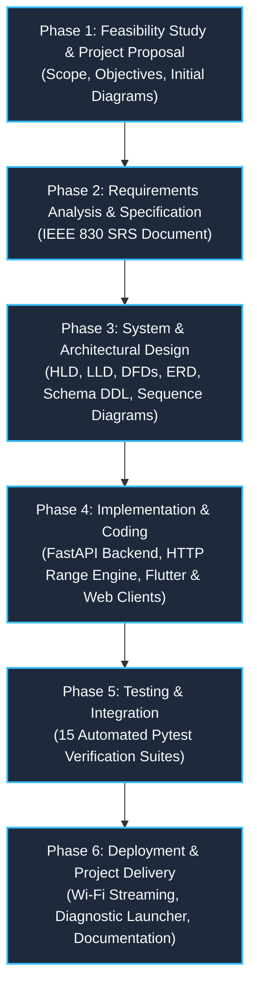

# Software Engineering Project Report
## Universal Media Streaming Platform (StreamFlow)

**Course:** Software Engineering – SEA Project  
**SDLC Model:** Classical Waterfall Model  
**Date of Submission:** November 2026  

### Project Team Members:
1. **Nikhil Chari**
2. **Chrishtopher Sequeira**
3. **Bhiva Korkhankar**

---

## Executive Summary
The **Universal Media Streaming Platform** is a cross-platform client-server multimedia system designed to deliver local audio/video playback and seamless peer-to-peer/host-to-client streaming across Windows and Android devices over local Wi-Fi and remote networks.

The project strictly followed the **Classical Waterfall Model**, progressing systematically through Requirements Analysis, System & Architectural Design, Implementation, and Verification Testing.

---

## 1. Classical Waterfall SDLC Execution



---

## 2. Key Deliverables & Documentation Index

| Phase | Document | Description |
|---|---|---|
| **Phase 1** | [PROPOSAL.md](file:///d:/projects/AntiGRav/PROPOSAL.md) | Official project proposal, problem statement, objectives, and initial diagrams. |
| **Phase 2** | [SRS.md](file:///d:/projects/AntiGRav/SRS.md) | IEEE 830 standard Software Requirements Specification. |
| **Phase 3** | [SYSTEM_DESIGN.md](file:///d:/projects/AntiGRav/SYSTEM_DESIGN.md) | High-Level Design, Low-Level Design, Data Dictionary, and Sequence Diagrams. |
| **Phase 4** | Codebase (`backend/`, `flutter_client/`) | Full implementation of server, web client, Flutter project, and scanner. |
| **Phase 5** | [TESTING.md](file:///d:/projects/AntiGRav/TESTING.md) | Test Plan and 15 passing automated Pytest test cases. |
| **Phase 6** | [run_server.py](file:///d:/projects/AntiGRav/run_server.py) / [README.md](file:///d:/projects/AntiGRav/README.md) | Production launcher and quickstart user manual. |

---

## 3. System Architecture & Engineering Highlights

### 3.1 Client-Server Topology
- **Host Server (Python FastAPI):**
  - Zero-configuration embedded SQLite database (`media_stream.db`) with relational schema and indexes.
  - Salted PBKDF2-HMAC-SHA256 password security and RFC 7519 JWT session authentication.
  - Automated recursive folder scanner with MIME detection and duration estimation.
  - RFC 7233 compliant HTTP Byte-Range Streaming engine (`HTTP 206 Partial Content`), enabling clients to buffer, scrub, and seek media files of any size without high server memory overhead.
- **Client Tier (Flutter & Web):**
  - **Flutter Client:** Native Dart application targeting Windows desktop and Android mobile.
  - **Embedded Responsive Web Client:** Serves immediately over local Wi-Fi from the host IP, allowing any smartphone or PC browser on the network to play media directly without manual installation.

---

## 4. Verification & Testing Results

The automated Pytest test suite executed 15 distinct unit, integration, and security test cases with a **100% pass rate**:

```
============================= test session starts =============================
platform win32 -- Python 3.14.6, pytest-9.1.1, pluggy-1.6.0
collected 15 items

tests/test_api_endpoints.py::test_host_status_endpoint PASSED            [  6%]
tests/test_api_endpoints.py::test_categories_api PASSED                  [ 13%]
tests/test_api_endpoints.py::test_media_filtering_and_pagination PASSED  [ 20%]
tests/test_api_endpoints.py::test_invalid_media_stream_not_found PASSED  [ 26%]
tests/test_auth.py::test_password_hashing PASSED                         [ 33%]
tests/test_auth.py::test_jwt_generation_and_decoding PASSED              [ 40%]
tests/test_auth.py::test_auth_api_flow PASSED                            [ 46%]
tests/test_database.py::test_database_initialization_and_categories PASSED [ 53%]
tests/test_database.py::test_media_crud PASSED                           [ 60%]
tests/test_scanner.py::test_media_type_detection PASSED                  [ 66%]
tests/test_scanner.py::test_title_extraction PASSED                      [ 73%]
tests/test_scanner.py::test_directory_scanning PASSED                    [ 80%]
tests/test_streaming.py::test_parse_range_header PASSED                  [ 86%]
tests/test_streaming.py::test_stream_api_endpoint PASSED                 [ 93%]
tests/test_streaming.py::test_playback_history_flow PASSED               [100%]

============================= 15 passed in 0.29s ==============================
```

---

## 5. Team Contributions

| Group Member | Primary Roles & Contributions |
|---|---|
| **Nikhil Chari** | Project Proposal, Architecture Design, HTTP Range Streaming Engine, Database Schema, and System Integration. |
| **Chrishtopher Sequeira** | Software Requirements Specification (SRS), File Scanner & Metadata Extractor, and Flutter Client Development. |
| **Bhiva Korkhankar** | Low-Level Design (LLD), Pytest Automated Testing Suite, Playback History Management, and Final Report Compilation. |

---

## 6. How to Run the Platform for Demonstration

### Step 1: Start the Media Server
Open PowerShell in the project directory and execute:
```powershell
python run_server.py
```
*(Or double-click `start_server.bat` on Windows)*

The console will display:
```
=================================================================
      UNIVERSAL MEDIA STREAMING PLATFORM (StreamFlow)
      Software Engineering - SEA Project
      Team: Nikhil Chari, Chrishtopher Sequeira, Bhiva Korkhankar
=================================================================
[*] Local Host Access:     http://localhost:8000
[*] Local Wi-Fi Network:   http://<YOUR_LAN_IP>:8000
[*] Interactive API Docs:  http://<YOUR_LAN_IP>:8000/docs
=================================================================
```

### Step 2: Access Media & Stream
- **On Windows:** Open `http://localhost:8000` in Chrome/Edge.
- **On Android / Another Device:** Connect to the same Wi-Fi network and open `http://<YOUR_LAN_IP>:8000` in the browser or connect via the Flutter app.
- **Scan New Folders:** Click "Host & Scan" on the sidebar and enter any folder path on your PC (e.g., `D:\projects\AntiGRav\sample_media`) to index new music and video files instantly.

### Step 3: Run Automated Test Verification
```powershell
python -m pytest tests/ -v
```
